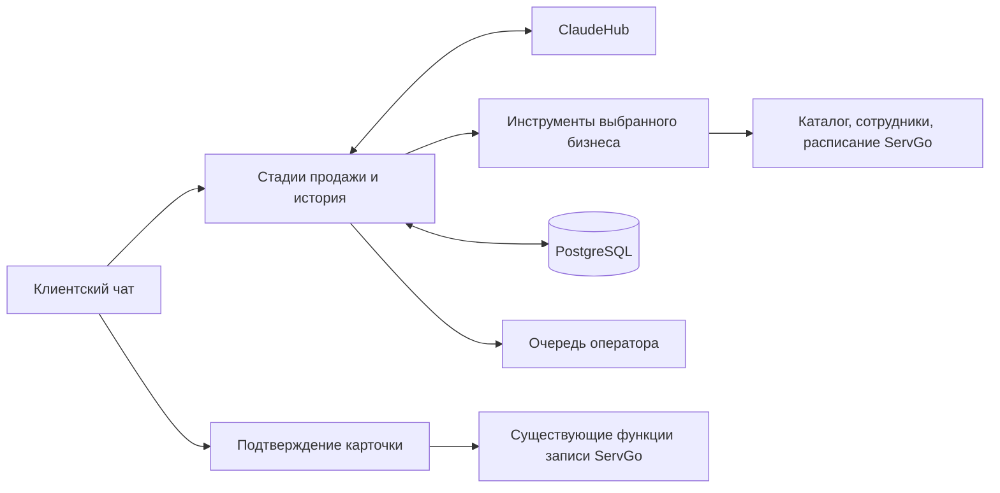

# ИИ-продавец ServGo

Вход по email без Telegram и веб-проверка предоплат описаны в
[отдельной инструкции](email-login-and-prepayment-review.md), включая дополнительную
миграцию, SMTP, изменённые файлы, проверки и откат.

Продавец встроен в существующие `/ai/chat`, `/ai/confirm`, `/ai/reject` и страницу
`/chat`. Он подбирает услугу по потребности, объясняет варианты, помогает с
сомнениями, предлагает специалиста и реальные окна, затем готовит карточку
записи. Клиент подтверждает карточку кнопкой. Создание записи использует те же
правила и функции ServGo, что обычная форма.



## Что взято из исходных проектов

- **SalesGPT**: исходная идея разделения анализа стадии и генерации следующего ответа
  (`StageAnalyzerChain`, `SalesConversationChain`, `SalesGPT.determine_conversation_stage`).
  Стадии адаптированы к покупке услуги: потребность → рекомендация → сомнения →
  специалист → окна → подтверждение → запись. Стадии можно пропускать и пересматривать.
- **LangGraph Sales Agent**: конфигурация и каталог привязаны к бизнесу, один
  ограниченный цикл «ассистент → инструменты → ассистент» обслуживает все бизнесы.
  PostgreSQL заменяет `InMemorySaver`.
- **Kaia**: клиентский чат, карточка записи, передача человеку и очередь диалогов.

Это адаптация подходов в существующий стек ServGo, без установки трёх приложений
целиком и без зависимостей от их LangChain/LangGraph-версий. Существующие
`Business/Service/Employee.ai_instruction` задают индивидуальные правила; они уже
редактируются в настройках бизнеса, услуг и сотрудников. LLM-провайдер пока общий
для инфраструктуры. Telegram/WhatsApp/Instagram-вебхуки и отдельный встраиваемый
виджет в этом изменении не добавлены. Источники, коммиты и MIT-уведомления:
[THIRD_PARTY_NOTICES](../THIRD_PARTY_NOTICES.md).

## Подключение ClaudeHub

Задайте в окружении процесса **web API**:

```dotenv
CLAUDEHUB_BASE_URL=https://YOUR-CLAUDEHUB-HOST/v1
CLAUDEHUB_API_KEY=SET-IN-SERVER-ENVIRONMENT
CLAUDEHUB_MODEL=YOUR-AVAILABLE-MODEL
CLAUDEHUB_CHAT_MODEL=YOUR-FAST-TOOL-CALLING-MODEL
CLAUDEHUB_API_FORMAT=openai
```

`BASE_URL` включает префикс API, но не конечный путь:

| Формат | Конечный путь | Авторизация |
| --- | --- | --- |
| `openai` | `{BASE_URL}/chat/completions` | `Authorization: Bearer ...` |
| `anthropic` | `{BASE_URL}/messages` | `x-api-key`, `anthropic-version: 2023-06-01` |

Для быстрого ответа можно задать отдельную `CLAUDEHUB_CHAT_MODEL` — конкретный
идентификатор быстрой модели, доступной **на вашем аккаунте** и поддерживающей
tool/function calling. Если переменная не задана, используется `CLAUDEHUB_MODEL`.
Не задавайте неподтверждённый идентификатор: список доступных моделей и задержка
ClaudeHub требуют проверки через ваш API. Выбор модели сам по себе не гарантирует
конкретного времени ответа.

Вкладка AI немедленно показывает сообщение клиента в состоянии «Отправляется…»,
а при сетевой ошибке — «Не отправлено · Повторить». Ответы модели безопасно
отображают выделение жирным/курсивом и простые маркеры списков без HTML-вставок.
Отдельный LLM-запрос для анализа стадии исключён из клиентского пути: стадия
обновляется после фактической проверки доступности, подготовки карточки и
подтверждения. Когда инструмент `check_availability` возвращает результат,
дополнительный LLM-запрос ради текстового перечисления слотов не нужен.

Результат `check_availability` сохраняет серверное предложение максимум на 10
минут и отображается интерактивной карточкой (кнопки «время · специалист»).
Новый `POST /ai/select-slot` принимает только `business_id`, `employee_id`,
`time`, проверяет, что слот содержится в актуальном предложении **этого
клиента и бизнеса**, и повторно использует `prepare_booking` (проверка
занятости, цены, тарифа и прав). Выбор подготавливает прежнюю 20-минутную
карточку подтверждения, но **не создаёт запись**. Запись создаётся только через
существующий `POST /ai/confirm`, который ещё раз проверяет слот и цену в
транзакции с блокировкой ресурса. Слоты других компаний, устаревшие и
подменённые вручную варианты отклоняются. Список не резервирует время.

Нужна модель/API с поддержкой tools. Адаптер переводит сообщения и результаты
инструментов между форматами. Ответы HTTP-ошибок не показываются клиенту. Нет
автоматического переключения на стороннего провайдера или встроенных ключей.
Отсутствующие настройки дают 503; история, кнопка оператора и обычная форма записи
продолжают работать. Реальная совместимость с вашим ClaudeHub требует проверки
его endpoint, модели и авторизации; локальные тесты проверяют оба контракта через
тестовый транспорт, без платных запросов.

Сначала примените `migrations/add_sales_conversations.sql`. Сервис должен работать
с PostgreSQL; SQLite подходит для последовательных локальных тестов. Временные
правила существующего API ориентированы на `Europe/Moscow`; настройка TZ web API
должна соответствовать текущему ServGo.

Для демонстрации откройте `/chat?business_id=<id>` или кнопку «Помочь выбрать
услугу» на странице бизнеса. Нужны активная услуга, совместимый активный
специалист/ресурс, рабочее расписание и актуальная цена. Владелец видит переданные
диалоги в `/admin/sales`; ответ появляется в клиентском чате автоматически, после
чего владелец может вернуть разговор ИИ.

## Инструменты и ограничения первой версии

| Инструмент | Данные/поведение |
| --- | --- |
| `get_services` | Активный каталог выбранной компании, поиск по названию |
| `get_service_details` | Описание, длительность, инструкции и тариф |
| `get_prices` | Фактическая стоимость и необходимость согласования менеджером |
| `get_specialists` | Активные мастера/ресурсы с учётом связей с услугой |
| `check_availability` | Существующий расчёт окон плюс проверка выходных и даты дежурства |
| `create_booking` | Карточка с именами и ценой из БД; резервирования до подтверждения нет |
| `handoff_to_human` | Сохранение причины, остановка ИИ и очередь владельца |
| `get_my_bookings` | Только записи текущего авторизованного клиента в выбранной компании |

Поддержана запись на одну основную услугу с фиксированной ценой и фиксированными
дополнительными услугами. Поддержана аренда через существующий `rental` API для
ресурсов с настроенным `solo_price_per_hour` и продолжительностью 1–12 часов.
Правило цены для короткой аренды остаётся прежним: менее 5 часов — согласование
менеджером. Создаётся заявка `pending`, предоплату назначает владелец.

Групповые, контактные, почасовые и другие нестандартные тарифы, включая аренду
помещений без `solo_price_per_hour`, идут через обычную форму/оператора. Второй
ценовой движок не создаётся. Отмена, перенос, отметка перевода и загрузка чека
остаются в существующих экранах управления записью; модель больше не выполняет
эти финансовые/изменяющие действия напрямую. Предоплата поступает бизнесу, а
получение денег подтверждает владелец.

## Состояние, подтверждение и изоляция

- Уникальный диалог: `(business_id, principal)`. Principal задаёт сервер: JWT,
  свежая подписанная Telegram initData или случайная HttpOnly-cookie гостя.
  Cookie хранится в БД только в виде SHA-256; гостевой чат не создаёт фиктивного
  пользователя до подтверждения записи. Вход в аккаунт начинает отдельный диалог
  от гостевого; автоматического объединения нет.
- История, краткие факты о потребности, стадия, очередь оператора и текущая
  карточка сохраняются в `sales_conversations`. Из истории удаляются только
  полные старые пользовательские ходы, включая все tool calls/results.
- PostgreSQL advisory transaction lock сериализует сообщения и подтверждения
  одного диалога между API-воркерами; существующие блокировки ресурсов защищают
  запись на одно время. Транзакция охватывает INSERT записи и сохранение результата
  подтверждения. Повторное нажатие возвращает сохранённый результат.
- Карточка действует 20 минут; новая карточка заменяет старую. Подтверждение
  повторно проверяет активность компании, принадлежность услуги/ресурса, дату,
  окно и цену. Изменившиеся условия требуют новой карточки. Модель не задаёт
  business/client ID; лишние поля инструмента отвергаются.
- Имя и телефон гостя собирает форма подтверждения, а не LLM. Юридические
  согласия — отдельные непредвыбранные поля, передаваемые существующему API.
  Аренда с включёнными юридическими документами пока направляется в обычный
  сценарий: rental API ещё не хранит эти два согласия.
- Кнопка оператора не вызывает LLM. В режиме `human` сообщения сохраняются,
  инструменты ИИ остановлены, ожидающая карточка удалена. Очередь и ответы
  доступны только владельцам/совладельцам соответствующего бизнеса. Оповещения
  оператора по внешним каналам и SLA ответа не добавлены.

Перед production-нагрузкой настройте ограничение частоты `/ai/*` на имеющемся
reverse proxy, лимит бюджета ClaudeHub и срок хранения диалогов по политике
ServGo. История ограничена 15 ходами для LLM; автоматическое удаление старых
диалогов из БД и аналитическая воронка пока не реализованы.

## Проверки

```bash
python -m pip install -r requirements.txt -r web/api/requirements.txt pytest aiosqlite python-multipart
BOT_TOKEN=test-token DATABASE_URL=sqlite+aiosqlite:///:memory: python -m pytest -q tests/test_sales_agent.py tests/test_rental_api.py tests/test_rental_logic.py tests/test_booking_safety.py tests/test_notification_rules.py tests/test_email_utils.py test_booking_utils.py
cd web/frontend
npm ci --legacy-peer-deps
npm run build
```

Для конкурентных проверок передайте `SERVGO_SALES_TEST_POSTGRES_URL` с адресом
**отдельной тестовой PostgreSQL**. Каждый тест создаёт уникальную схему
`sales_test_<uuid>` и удаляет только её. Проверяются двойное подтверждение,
конкуренция клиентов за ресурс и создание диалога при параллельных сообщениях.
CI запускает их на отдельном PostgreSQL service container.

## Развёртывание и откат

Производственный код может отличаться от GitHub; перед выкладкой сверить
затронутые файлы с сервером согласно `CLAUDE.md`. Не копировать весь репозиторий
на production. Этот PR сам ничего не развёртывает.

1. Сохранить версии затронутых production-файлов и конфигурации API.
2. Применить только additive SQL-миграцию. Удаления/изменения существующих таблиц нет.
3. Настроить ClaudeHub в окружении web API и его зависимости из
   `web/api/requirements.txt` (новых runtime-зависимостей нет).
4. Доставить `database/models.py`, `web/api/sales/*.py`, `web/api/routes/ai.py`,
   `web/api/routes/client.py`, `web/api/rental.py`, `web/api/schemas.py`; заменить
   frontend build, полученный из изменённых `web/frontend/src`.
5. Перезапустить службу web API (`booking-web-api`, сверить фактическое имя на
   сервере). Бот не получает нового обработчика; общий `models.py` должен быть
   синхронизирован, но отдельный перезапуск бота для этого сценария не требуется.
6. Проверить `/api/health`, историю и сообщение выбранной компании, инструмент
   каталога/окон, передачу оператору. Проверку настоящего создания записи
   проводить в выделенном demo-бизнесе, затем проверить её статус и уведомления.

При откате восстановить прежние файлы API и frontend build, перезапустить web
API. Новую таблицу оставить: она не мешает предыдущей версии, а записи клиентов
хранятся в обычной `bookings`. Откат таблицы или удаление созданных записей не
нужны. Старые диалоги из памяти исходного AI-чата не мигрируют.

В текущем GitHub checkout полный `web.api.main` также зависит от внешнего
`servgo_auth`, отсутствующего в репозитории. Это существующее требование
развёртывания; тесты продавца подключают его роутер и существующие функции записи
на отдельном FastAPI test app, не подменяя production-модуль авторизации.

## Operator inbox and capability settings

ServGo admin: `/admin/sales` shows the latest 50 active handoffs for the selected
business, with message previews, timestamps, owner replies and return to AI.
`/admin/sales/settings` controls enabled state, price reads, specialist selection,
availability reads, access to the signed-in client's own bookings and booking mode.
`client_confirmation` creates the real booking only after the client's confirmation
button; `operator_only` forbids AI booking. Missing price/availability permission
also forbids booking. Topic exclusions and custom instructions guide the model;
capability checks run on the server even if the model requests a forbidden tool.
Existing `Business.ai_instruction` is the initial instruction; saving an empty
instruction explicitly clears it for the sales agent.

Apply `migrations/add_sales_agent_settings.sql` before this API version starts.
The JSON policy is tenant-scoped and revision checked. A revoked booking permission
blocks already-issued cards; booking confirmation locks the business permission
row until commit. Completed receipts remain idempotent and accessible.

AI Growth OS implements `/studio/products/{servgo_product_uuid}/sales-agent` in
`grunvald91/Ai_growth_os`. It reads and updates these same settings, rather than a
separate copy. Configure `SERVGO_PLATFORM_API_TOKEN` (random, >=32 characters) and
`SERVGO_PLATFORM_BUSINESS_IDS` (comma-separated permitted IDs) in ServGo. Set the
matching token and `SERVGO_API_BASE_URL` (usually `https://<servgo-host>/api`) only
on the Growth OS server. It also requires its own owner login password. Neither
integration token appears in frontend payloads or LLM prompts. Empty business
scope denies all companies. Do not use the ClaudeHub credential for this channel.

## Booking rule coverage

| Rule | Sales agent behavior |
| --- | --- |
| Business / employee slot step and opening hours | Calls existing slot APIs; today's grid stays anchored to opening time, in Europe/Moscow |
| Busy resources, interval overlaps and concurrent confirmations | Existing shared booking locks and overlap checks; full interval rechecked |
| Breaks, minimum duration, day off, duty calendar | Checked by shared API/helper, including rental; calendar takes precedence over a single duty date |
| Service/resource assignment and active state | Tenant catalog, assignment links, available_employee_ids, active resources |
| Fixed prices and fixed addons | Uses existing ordinary booking function |
| Prepayment enabled/percent, cancellation terms, receipt requirement | Shown in quote/card; existing booking status, amount and subsequent receipt/payment flow reused |
| Separate legal consents | Separate client checkboxes; saved by ordinary booking function |
| Rental duration and hourly base rate | Existing rental API, whole-hour duration 1–12h, business/resource start step; short rental price and deposit decided by operator |
| Rental deposit | Existing rental policy: operator assigns deposit, max 20%; it does not automatically use the generic business prepayment percent |
| Business flow order / labels / agent instructions | Supplied to sales prompt; editable instructions and explicit permissions |
| Complex/time-based/group tariffs, subscriptions, legal-enabled rental, overnight schedules | Ordinary booking form or operator; never silently substituted with a fixed-price booking |
| Payment verification, receipt upload, reschedule/cancellation | Existing booking status/manage page or operator; agent cannot mark money received |

This is not complete parity with every legacy bot/webapp flow. There are distinct
ordinary-booking, rental and legacy webapp pricing implementations in ServGo.
Unsupported scenarios must remain on their existing form/operator path until their
booking adapters are covered by contract tests. No production migration or rollout
is performed by this change.

## Shared ten-minute prepayment window (services, rooms and vessels)

The payment window depends on required prepayment, never on business/resource
kind or the channel that created the booking. Ordinary prepayment bookings keep
the existing ten-minute window from creation. In the rental quote path, requesting
a positive deposit moves the booking from `pending` to `pending_prepayment` and
sets `prepayment_requested_at`; the client gets ten minutes from that request,
even if the original request was created much earlier. Repeating the same quote
does not extend its window. Zero-deposit rental quotes remain `pending` with no
payment timer. Existing rental price calculation and operator deposit limits are
preserved. An unquoted request cannot start a payment clock without a bill.

`database/prepayment.py` is the shared deadline/expiry implementation. The existing
bot scheduler still runs expiry every two minutes: unpaid bookings become
`cancelled` and release their resource. The API also rejects payment submission
after the deadline and cannot revive a cancelled booking. Row locks serialize
expiry with payment/receipt submission. `prepayment_sent` is protected from expiry;
only the owner can confirm receipt of money. Explicit zero amounts are excluded.

Both `/b/:token` and the existing `/rental/b/:token` render the same payment/status
page, with the actual rental quote, duration, payment deadline, business payment
details, and optional/required receipt upload. The twenty-minute chat confirmation
card lifetime is separate: that card has not reserved a slot yet.

### Scoped rollout and rollback

No production rollout is performed by this PR. Reconcile the touched production
sources first, as required by CLAUDE.md. Deploy only the changed API/sales modules,
`web/api/schemas.py`, `database/models.py`, `database/prepayment.py`,
`bot/services/notifications.py`, and rebuilt frontend assets, with their matching
versions; the exact full file list is in the commit diff.

1. Apply `migrations/add_prepayment_requested_at.sql` before restarting the new API
   and `booking-bot`. It only adds a nullable column and starts no payment timers.
2. Deploy the matched API, worker and frontend; restart their existing services.
   Check API health, the scheduler's expiry job and both booking status URLs.
3. Only after all components are healthy, apply
   `migrations/activate_rental_prepayment_windows.sql`. Existing finalized rental
   quotes with positive deposits get a new ten-minute window. Zero-deposit,
   unquoted, submitted-payment and confirmed reservations are untouched. Repeating
   this activation does not restart already-running windows.
4. Verify a synthetic positive-deposit booking expires and releases its slot;
   a zero-deposit booking does not; submitted payment remains awaiting the owner.

Retain the nullable column on rollback. API/frontend changes can be rolled back
without deleting bookings. Keep the new expiry worker/deadline helper until active
rental windows have drained: reverting that worker to creation-time expiry while
newly quoted old requests still exist would cancel them early. Do not mass-reset
booking states or resurrect cancelled reservations during rollback.
