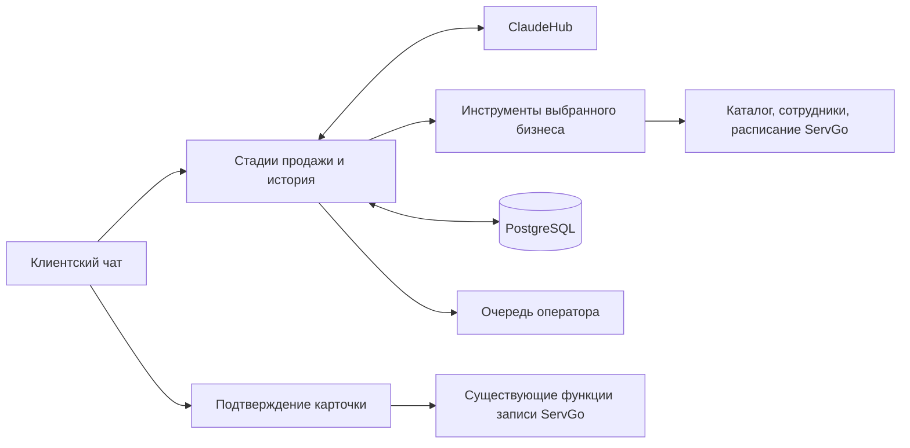

# ИИ-продавец ServGo

Продавец встроен в существующие `/ai/chat`, `/ai/confirm`, `/ai/reject` и страницу
`/chat`. Он подбирает услугу по потребности, объясняет варианты, помогает с
сомнениями, предлагает специалиста и реальные окна, затем готовит карточку
записи. Клиент подтверждает карточку кнопкой. Создание записи использует те же
правила и функции ServGo, что обычная форма.



## Что взято из исходных проектов

- **SalesGPT**: разделение анализа стадии и генерации следующего ответа
  (`StageAnalyzerChain`, `SalesConversationChain`, `SalesGPT.determine_conversation_stage`).
  Стадии адаптированы к покупке услуги: потребность → рекомендация → сомнения →
  специалист → окна → подтверждение → запись. Стадии можно пропускать и пересматривать.
- **LangGraph Sales Agent**: конфигурация и каталог привязаны к бизнесу, один
  ограниченный цикл «ассистент → инструменты → ассистент» обслуживает все бизнесы.
  PostgreSQL заменяет `InMemorySaver`.
- **Kaia**: клиентский чат, карточка записи, передача человеку и очередь диалогов.

Это адаптация подходов в существующий стек ServGo, без установки трёх приложений
целиком и без зависимостей от их LangChain/LangGraph-версий. Существующие
`Business/Service/Employee.ai_instruction` задают индивидуальные правила; они уже
редактируются в настройках бизнеса, услуг и сотрудников. LLM-провайдер пока общий
для инфраструктуры. Telegram/WhatsApp/Instagram-вебхуки и отдельный встраиваемый
виджет в этом изменении не добавлены. Источники, коммиты и MIT-уведомления:
[THIRD_PARTY_NOTICES](../THIRD_PARTY_NOTICES.md).

## Подключение ClaudeHub

Задайте в окружении процесса **web API**:

```dotenv
CLAUDEHUB_BASE_URL=https://YOUR-CLAUDEHUB-HOST/v1
CLAUDEHUB_API_KEY=SET-IN-SERVER-ENVIRONMENT
CLAUDEHUB_MODEL=YOUR-AVAILABLE-MODEL
CLAUDEHUB_API_FORMAT=openai
```

`BASE_URL` включает префикс API, но не конечный путь:

| Формат | Конечный путь | Авторизация |
| --- | --- | --- |
| `openai` | `{BASE_URL}/chat/completions` | `Authorization: Bearer ...` |
| `anthropic` | `{BASE_URL}/messages` | `x-api-key`, `anthropic-version: 2023-06-01` |

Нужна модель/API с поддержкой tools. Адаптер переводит сообщения и результаты
инструментов между форматами. Ответы HTTP-ошибок не показываются клиенту. Нет
автоматического переключения на стороннего провайдера или встроенных ключей.
Отсутствующие настройки дают 503; история, кнопка оператора и обычная форма записи
продолжают работать. Реальная совместимость с вашим ClaudeHub требует проверки
его endpoint, модели и авторизации; локальные тесты проверяют оба контракта через
тестовый транспорт, без платных запросов.

Сначала примените `migrations/add_sales_conversations.sql`. Сервис должен работать
с PostgreSQL; SQLite подходит для последовательных локальных тестов. Временные
правила существующего API ориентированы на `Europe/Moscow`; настройка TZ web API
должна соответствовать текущему ServGo.

Для демонстрации откройте `/chat?business_id=<id>` или кнопку «Помочь выбрать
услугу» на странице бизнеса. Нужны активная услуга, совместимый активный
специалист/ресурс, рабочее расписание и актуальная цена. Владелец видит переданные
диалоги в `/admin/sales`; ответ появляется в клиентском чате автоматически, после
чего владелец может вернуть разговор ИИ.

## Инструменты и ограничения первой версии

| Инструмент | Данные/поведение |
| --- | --- |
| `get_services` | Активный каталог выбранной компании, поиск по названию |
| `get_service_details` | Описание, длительность, инструкции и тариф |
| `get_prices` | Фактическая стоимость и необходимость согласования менеджером |
| `get_specialists` | Активные мастера/ресурсы с учётом связей с услугой |
| `check_availability` | Существующий расчёт окон плюс проверка выходных и даты дежурства |
| `create_booking` | Карточка с именами и ценой из БД; резервирования до подтверждения нет |
| `handoff_to_human` | Сохранение причины, остановка ИИ и очередь владельца |
| `get_my_bookings` | Только записи текущего авторизованного клиента в выбранной компании |

Поддержана запись на одну основную услугу с фиксированной ценой и фиксированными
дополнительными услугами. Поддержана аренда через существующий `rental` API для
ресурсов с настроенным `solo_price_per_hour` и продолжительностью 1–12 часов.
Правило цены для короткой аренды остаётся прежним: менее 5 часов — согласование
менеджером. Создаётся заявка `pending`, предоплату назначает владелец.

Групповые, контактные, почасовые и другие нестандартные тарифы, включая аренду
помещений без `solo_price_per_hour`, идут через обычную форму/оператора. Второй
ценовой движок не создаётся. Отмена, перенос, отметка перевода и загрузка чека
остаются в существующих экранах управления записью; модель больше не выполняет
эти финансовые/изменяющие действия напрямую. Предоплата поступает бизнесу, а
получение денег подтверждает владелец.

## Состояние, подтверждение и изоляция

- Уникальный диалог: `(business_id, principal)`. Principal задаёт сервер: JWT,
  свежая подписанная Telegram initData или случайная HttpOnly-cookie гостя.
  Cookie хранится в БД только в виде SHA-256; гостевой чат не создаёт фиктивного
  пользователя до подтверждения записи. Вход в аккаунт начинает отдельный диалог
  от гостевого; автоматического объединения нет.
- История, краткие факты о потребности, стадия, очередь оператора и текущая
  карточка сохраняются в `sales_conversations`. Из истории удаляются только
  полные старые пользовательские ходы, включая все tool calls/results.
- PostgreSQL advisory transaction lock сериализует сообщения и подтверждения
  одного диалога между API-воркерами; существующие блокировки ресурсов защищают
  запись на одно время. Транзакция охватывает INSERT записи и сохранение результата
  подтверждения. Повторное нажатие возвращает сохранённый результат.
- Карточка действует 20 минут; новая карточка заменяет старую. Подтверждение
  повторно проверяет активность компании, принадлежность услуги/ресурса, дату,
  окно и цену. Изменившиеся условия требуют новой карточки. Модель не задаёт
  business/client ID; лишние поля инструмента отвергаются.
- Имя и телефон гостя собирает форма подтверждения, а не LLM. Юридические
  согласия — отдельные непредвыбранные поля, передаваемые существующему API.
  Аренда с включёнными юридическими документами пока направляется в обычный
  сценарий: rental API ещё не хранит эти два согласия.
- Кнопка оператора не вызывает LLM. В режиме `human` сообщения сохраняются,
  инструменты ИИ остановлены, ожидающая карточка удалена. Очередь и ответы
  доступны только владельцам/совладельцам соответствующего бизнеса. Оповещения
  оператора по внешним каналам и SLA ответа не добавлены.

Перед production-нагрузкой настройте ограничение частоты `/ai/*` на имеющемся
reverse proxy, лимит бюджета ClaudeHub и срок хранения диалогов по политике
ServGo. История ограничена 15 ходами для LLM; автоматическое удаление старых
диалогов из БД и аналитическая воронка пока не реализованы.

## Проверки

```bash
python -m pip install -r requirements.txt -r web/api/requirements.txt pytest aiosqlite python-multipart
BOT_TOKEN=test-token DATABASE_URL=sqlite+aiosqlite:///:memory: python -m pytest -q tests/test_sales_agent.py tests/test_rental_api.py tests/test_rental_logic.py tests/test_booking_safety.py tests/test_notification_rules.py tests/test_email_utils.py test_booking_utils.py
cd web/frontend
npm ci --legacy-peer-deps
npm run build
```

Для конкурентных проверок передайте `SERVGO_SALES_TEST_POSTGRES_URL` с адресом
**отдельной тестовой PostgreSQL**. Каждый тест создаёт уникальную схему
`sales_test_<uuid>` и удаляет только её. Проверяются двойное подтверждение,
конкуренция клиентов за ресурс и создание диалога при параллельных сообщениях.
CI запускает их на отдельном PostgreSQL service container.

## Развёртывание и откат

Производственный код может отличаться от GitHub; перед выкладкой сверить
затронутые файлы с сервером согласно `CLAUDE.md`. Не копировать весь репозиторий
на production. Этот PR сам ничего не развёртывает.

1. Сохранить версии затронутых production-файлов и конфигурации API.
2. Применить только additive SQL-миграцию. Удаления/изменения существующих таблиц нет.
3. Настроить ClaudeHub в окружении web API и его зависимости из
   `web/api/requirements.txt` (новых runtime-зависимостей нет).
4. Доставить `database/models.py`, `web/api/sales/*.py`, `web/api/routes/ai.py`,
   `web/api/routes/client.py`, `web/api/rental.py`, `web/api/schemas.py`; заменить
   frontend build, полученный из изменённых `web/frontend/src`.
5. Перезапустить службу web API (`booking-web-api`, сверить фактическое имя на
   сервере). Бот не получает нового обработчика; общий `models.py` должен быть
   синхронизирован, но отдельный перезапуск бота для этого сценария не требуется.
6. Проверить `/api/health`, историю и сообщение выбранной компании, инструмент
   каталога/окон, передачу оператору. Проверку настоящего создания записи
   проводить в выделенном demo-бизнесе, затем проверить её статус и уведомления.

При откате восстановить прежние файлы API и frontend build, перезапустить web
API. Новую таблицу оставить: она не мешает предыдущей версии, а записи клиентов
хранятся в обычной `bookings`. Откат таблицы или удаление созданных записей не
нужны. Старые диалоги из памяти исходного AI-чата не мигрируют.

В текущем GitHub checkout полный `web.api.main` также зависит от внешнего
`servgo_auth`, отсутствующего в репозитории. Это существующее требование
развёртывания; тесты продавца подключают его роутер и существующие функции записи
на отдельном FastAPI test app, не подменяя production-модуль авторизации.
